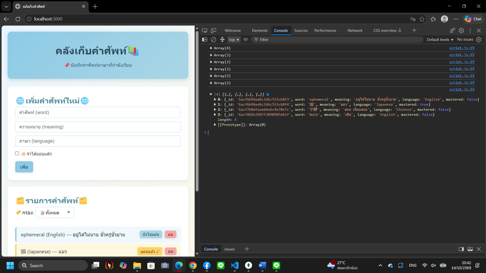
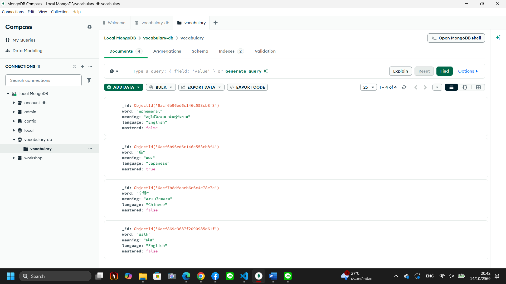
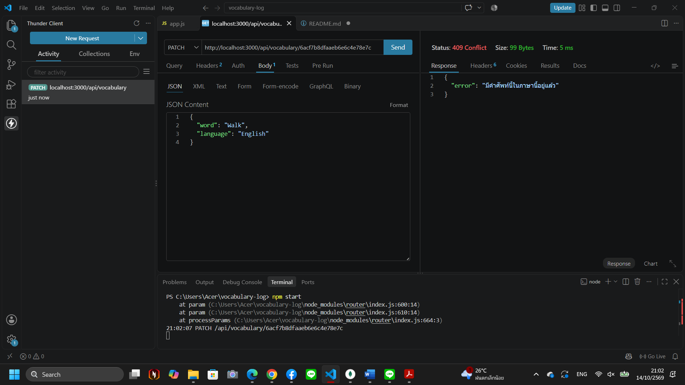

# คลังเก็บคำศัพท์ (vocabulary-log รุ่นปรับปรุง)
เว็บแอปพลิเคชันสำหรับบันทึกและจัดการคำศัพท์ของภาษาที่กำลังเรียน พัฒนาเป็น full-stack ด้วยการสร้าง REST API ที่เชื่อมต่อกับฐานข้อมูล MongoDB โดยหน้าเว็บเรียกใช้ API ผ่าน `fetch()` และอัปเดตรายการทันทีโดยไม่ต้องรีเฟรชหน้า

ผู้ใช้งานสามารถ:

- ดูรายการคำศัพท์ทั้งหมด (คำศัพท์, ความหมาย, ภาษา, สถานะ)
- เพิ่มคำศัพท์ใหม่ผ่านฟอร์ม
- สลับสถานะของแต่ละคำระหว่าง "ยังไม่แม่น" กับ "แม่นแล้ว"
- กรองรายการตามสถานะ เช่น ดูเฉพาะคำที่ยังไม่แม่น
- ลบคำศัพท์ที่ไม่ต้องการ

ระบบจะไม่ให้เพิ่มคำเดียวกันซ้ำในภาษาเดียวกัน (เช่น `walk` ภาษา English) แต่คำที่สะกดเหมือนกันในคนละภาษาเพิ่มได้ และข้อมูลทั้งหมดเก็บอยู่ใน MongoDB จึงไม่หายเมื่อปิดหรือรีสตาร์ตเซิร์ฟเวอร์

## Technologies Used

- Backend: Node.js, Express.js
- Database: MongoDB (เชื่อมต่อด้วย MongoDB Node.js Driver)
- Frontend: HTML, CSS, JavaScript

## Installation
```npm install```
คำสั่งนี้จะทำการอ่านรายชื่อ Package ทั้งหมดที่ระบุไว้ในไฟล์ package.json แล้วดาวน์โหลดเข้ามาสร้างเป็นโฟลเดอร์ node_modules โดยอัตโนมัติ 

## Usage
ต้องเปิด MongoDB ไว้ก่อน (ถ้าติดตั้งบน Windows แบบ Service ระบบจะรันให้เองทุกครั้งที่เปิดเครื่อง) จากนั้นรัน
```​npm run dev```
คำสั่งนี้จะไปเรียกใช้สคริปต์ที่ระบุไว้ในไฟล์ package.json เพื่อเริ่มทำงานที่ http://localhost:3000 โดยระบบจะทำการรีสตาร์ตเซิร์ฟเวอร์ให้อัตโนมัติทุกครั้งที่มีการแก้ไขและบันทึกไฟล์โค้ด ช่วยให้การพัฒนาและทดสอบ API มีความสะดวกต่อเนื่อง
ถ้าทำงานสำเร็จ จะเห็นข้อความใน terminal ดังนี้

"เชื่อมต่อ MongoDB สำเร็จ
 Server is running at http://localhost:3000/"

ข้อมูลเก็บในฐานข้อมูลชื่อ `vocabulary-db` collection ชื่อ `vocabulary` และถ้ายังไม่มีข้อมูล ระบบจะเพิ่มคำศัพท์ตัวอย่างให้ 3 คำในการรันครั้งแรก หากไม่ต้องการให้รีสตาร์ตอัตโนมัติ สามารถใช้ `npm start` แทนได้

## หากรันแล้วเกิดปัญหา
- ขึ้นข้อความ "เชื่อมต่อฐานข้อมูลไม่สำเร็จ" แสดงว่า MongoDB ยังไม่ทำงาน ให้เปิด MongoDB ก่อนแล้วรันใหม่ (อาจใช้เวลารอประมาณ 30 วินาทีกว่าจะขึ้นข้อความ)
- ขึ้นข้อความว่ามีคำศัพท์ซ้ำอยู่ในฐานข้อมูลเดิม ให้ลบคำที่ซ้ำ (คำเดียวกันในภาษาเดียวกัน) ออกใน Compass แล้วรันใหม่

## API Endpoints
- GET /api/vocabulary
- GET /api/vocabulary/:id
- POST /api/vocabulary
- PATCH /api/vocabulary/:id
- DELETE /api/vocabulary/:id

## Debug Screenshots


